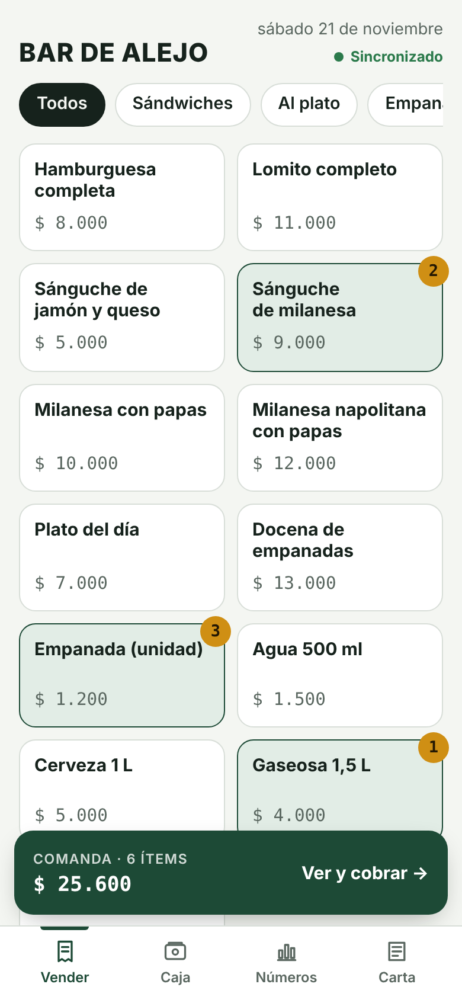
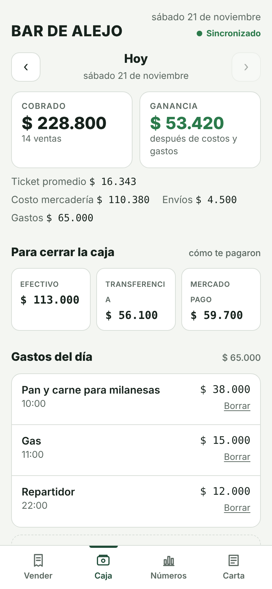
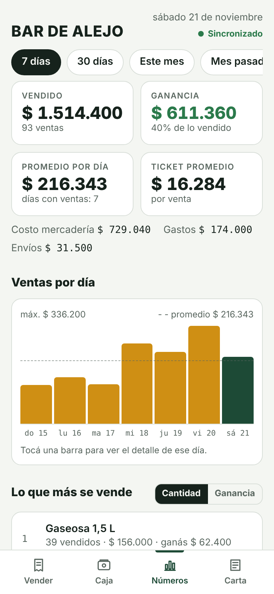
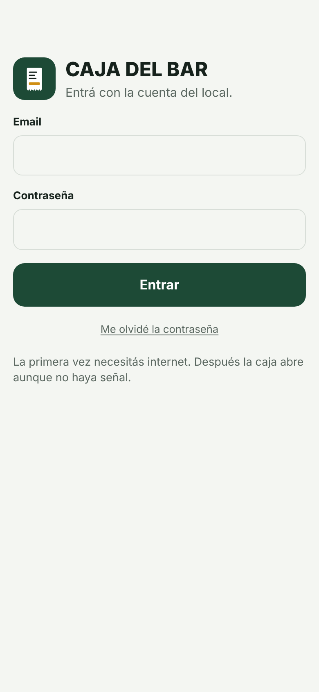
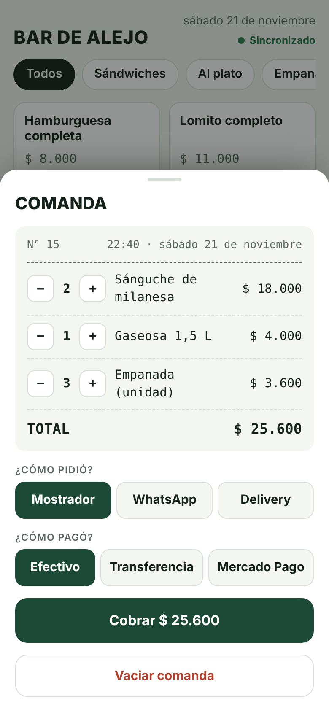
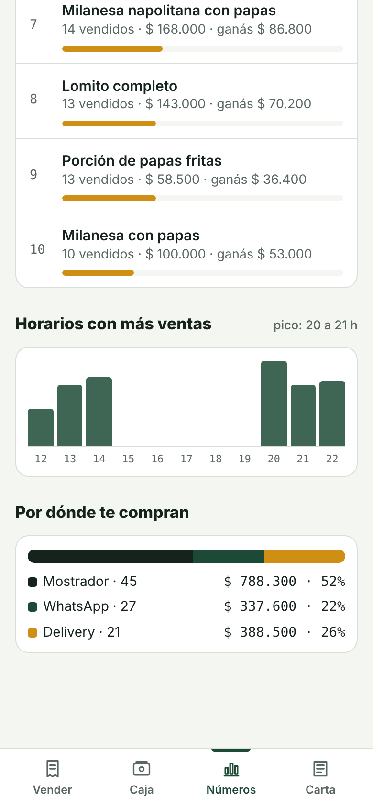
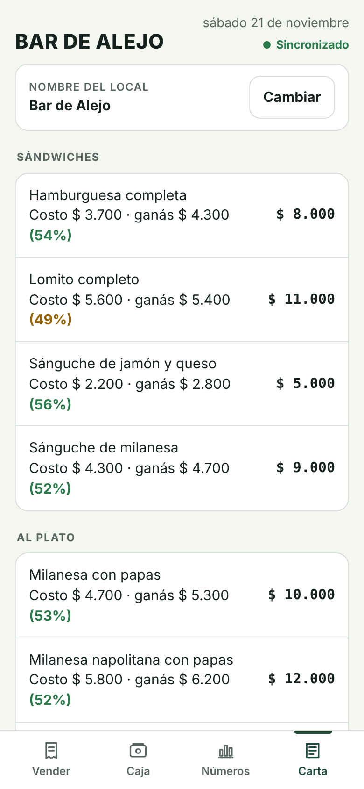
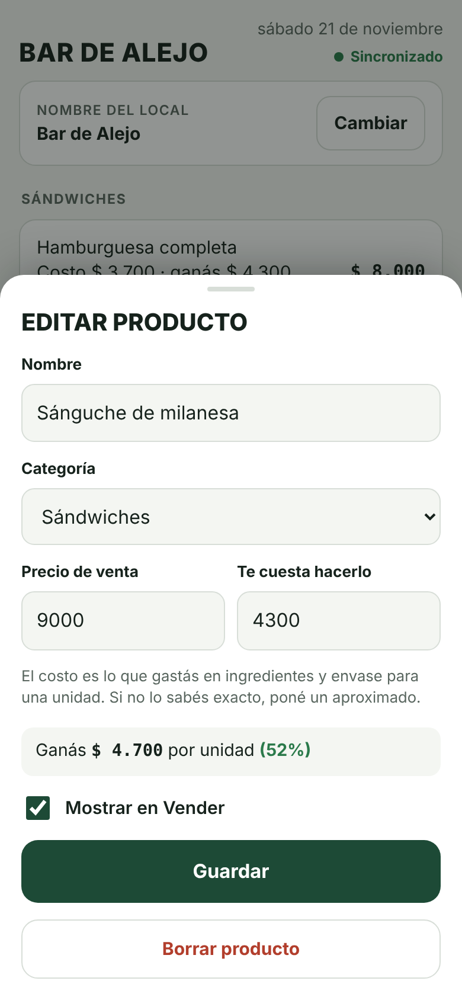
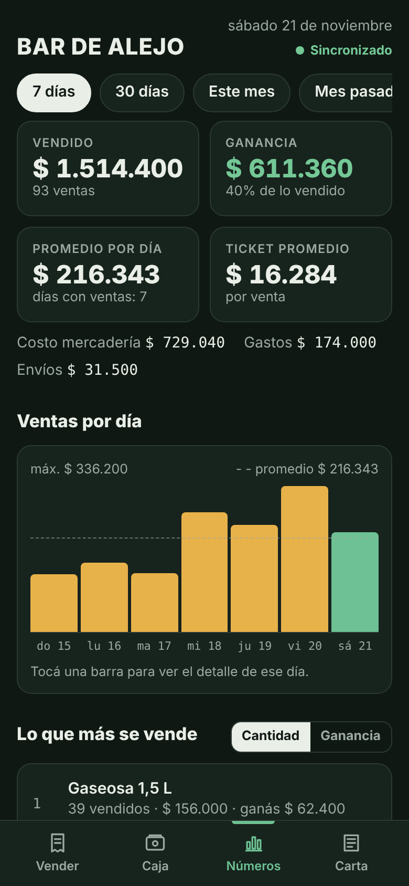

# Caja del Bar

Aplicación web para manejar la caja de un bar o rotisería desde el celular: cargar ventas, anotar gastos, cerrar la caja del día y ver cuánto se gana con cada producto.

Funciona **sin internet** y **se sincroniza entre celulares**: lo que se carga en uno aparece al instante en los otros, y si se corta la señal la app sigue andando y sube los cambios cuando vuelve.

  
  
  

## El problema

En muchos bares chicos la caja se lleva en un cuaderno o en la cabeza del dueño. Al final del día no se sabe bien cuánto entró en efectivo y cuánto por transferencia, cuánto se gastó en mercadería ni qué productos dejan más ganancia.

Caja del Bar reemplaza el cuaderno con una app pensada para usarse rápido, con una mano y en medio del servicio.

## Qué hace

- **Vender:** se arma la comanda tocando los productos, se elige cómo pidió el cliente (mostrador, WhatsApp o delivery) y cómo pagó (efectivo, transferencia o Mercado Pago).
- **Caja del día:** muestra lo cobrado, la ganancia después de costos y gastos, el ticket promedio y cuánto entró por cada medio de pago, para cerrar la caja sin hacer cuentas. Se pueden anotar gastos y revisar días anteriores.
- **Números:** resumen por período (7 días, 30 días, este mes, mes pasado, año) con ventas por día, productos más vendidos o más rentables, horarios de más movimiento y por dónde compran los clientes.
- **Carta:** cada producto tiene precio de venta y costo, y la app muestra cuánto se gana por unidad y con qué margen (verde, amarillo o rojo).
- **Copias y Excel:** se puede bajar una copia de seguridad (.json), exportar las ventas a Excel (.csv) y restaurar una copia.
- **Varios locales:** cada bar entra con su propia cuenta y solo ve sus datos.
- **Se instala como app** en Android y iPhone, y tiene modo oscuro automático.

## Capturas

> Las capturas usan datos de ejemplo de un bar ficticio.

| Ingreso | Vender | Comanda |
|:---:|:---:|:---:|
|  |  |  |
| Cada local entra con su cuenta. | Se tocan los productos y se arma la comanda. | Se elige canal y medio de pago, y se cobra. |

| Caja del día | Números | Horarios y canales |
|:---:|:---:|:---:|
|  |  |  |
| Cobrado, ganancia, cierre por medio de pago y gastos. | Ventas, ganancia y ventas por día del período. | Horas pico y de dónde vienen las ventas. |

| Carta | Editar producto | Modo oscuro |
|:---:|:---:|:---:|
|  |  |  |
| Precio, costo y margen de cada producto. | Calcula la ganancia por unidad al cargar el costo. | Se adapta al tema del celular. |

## Tecnologías

- **HTML, CSS y JavaScript**, sin frameworks. Diseño pensado primero para celular.
- **Firebase Authentication** para el ingreso con email y contraseña de cada local.
- **Cloud Firestore** como base de datos en la nube, con caché local para que funcione sin conexión y sincronice en tiempo real entre dispositivos.
- **Reglas de seguridad de Firestore** (`firestore.rules`): cada cuenta solo puede leer y escribir sus propios datos.
- **PWA** (service worker y manifest): se instala en el celular y abre aunque no haya señal.

## Estructura

| Archivo | Qué es |
|---|---|
| `index.html` | Estructura y estilos de la app. |
| `app.js` | Lógica de la app, ya empaquetada junto con el SDK de Firebase. |
| `firebase-config.js` | Datos del proyecto de Firebase (se completan al instalar). |
| `firestore.rules` | Reglas de seguridad de la base de datos. |
| `sw.js` | Service worker para que la app abra sin internet. |
| `manifest.webmanifest`, `icon-*.png` | Datos e íconos para instalarla en el celular. |
| `LEEME.txt` | Guía paso a paso para ponerla en marcha. |

## Cómo ponerla en marcha

1. Crear un proyecto gratuito en [Firebase](https://console.firebase.google.com), activar el ingreso con email y crear la base de datos Firestore.
2. Pegar las reglas de `firestore.rules` en Firestore.
3. Completar `firebase-config.js` con los datos del proyecto.
4. Publicar la carpeta en cualquier hosting estático (Netlify, GitHub Pages, etc.).
5. Crear un usuario por cada local en Firebase Authentication.

La guía completa, con cada paso explicado, está en [`LEEME.txt`](LEEME.txt).
